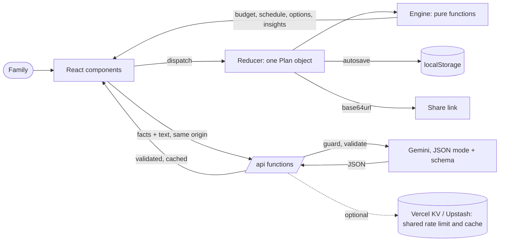

# Architecture

UtsavIQ is a single-page React app with a pure TypeScript engine and five thin serverless functions that talk to Gemini. One rule shapes everything: **deterministic code owns money and dates; the AI only handles language.**

## Layers

| Layer      | Folder           | Responsibility                                                                                                                                                                                                                                                                  | Depends on          |
| ---------- | ---------------- | ------------------------------------------------------------------------------------------------------------------------------------------------------------------------------------------------------------------------------------------------------------------------------- | ------------------- |
| Schemas    | `src/schemas`    | zod schemas and inferred types for the plan, quotes, AI requests and AI responses. Used by the client, the server and the tests.                                                                                                                                                | zod                 |
| Engine     | `src/engine`     | All business logic as pure functions: allocation, redistribution, scheduling, compression, delay propagation, trade-offs, quote analysis, vendor checklist, assistant insights, built-in answers, calendar export. No React, no clock (`today` is a parameter), integer rupees. | schemas             |
| State      | `src/state`      | `useReducer` store, validated autosave, validated share links. Every action calls the engine.                                                                                                                                                                                   | engine, schemas     |
| UI         | `src/components` | Rendering and dispatching only. Components never compute money or dates.                                                                                                                                                                                                        | engine, state, lib  |
| Client lib | `src/lib`        | Typed API client with timeouts and cancellation, AI request hook, theme, formatting, downloads.                                                                                                                                                                                 | schemas             |
| API        | `api/`           | One file per endpoint, each `createHandler({ name, input, run })`.                                                                                                                                                                                                              | `api/_lib`, schemas |
| API lib    | `api/_lib`       | HTTP guards (method, origin, content type, size, rate limit), cache, optional shared store, Gemini client with failover, prompts.                                                                                                                                               | @google/genai, zod  |

## The plan object

Everything the family enters lives in one `Plan` (see `src/schemas/base.ts`): occasion, total budget, guests, date, vibe, priorities, allocation per category, locks, per-plate estimate, tasks, quotes and contacted vendors. Changing any field re-runs the engine, so budget, timeline, checklist, assistant and print summary always agree.

## Key algorithms

| Problem                               | Approach                                                                                                                                                | Where                        |
| ------------------------------------- | ------------------------------------------------------------------------------------------------------------------------------------------------------- | ---------------------------- |
| Split a budget exactly                | Preset percentages, priorities weighted x1.25, renormalised to 90% plus a 10% buffer, then largest-remainder rounding so parts sum exactly to the total | `budget.ts`, `money.ts`      |
| Move money without breaking the total | Spread the change over unlocked categories in proportion to their size; cap at what they can give                                                       | `budget.ts` (`redistribute`) |
| Close an overspend                    | Up to three options (fewer guests, trim flexible categories, use the buffer), each with exact rupee changes, applied only on request                    | `tradeoffs.ts`               |
| Schedule with dependencies            | Topological order, cycle detection, effective date = max(own due + delay, dependency end)                                                               | `timeline.ts`                |
| Event closer than the usual lead time | Leads and durations shrink proportionally, rounded down, which provably keeps every dependency satisfiable (property-tested)                            | `compression.ts`             |
| What needs attention                  | Ranked insights across budget, timeline and vendors with a link to the fix                                                                              | `insights.ts`                |
| Answer questions without AI           | Topic detection (English and Hinglish) answered from engine facts                                                                                       | `advisor.ts`                 |

## AI request lifecycle

1. The browser sends facts computed by the engine plus the family's text to `/api/<endpoint>` (same origin only).
2. `createHandler` checks method, origin, content type, rate limit and body size, then validates the body with zod.
3. A cache lookup (memory, then the optional shared store) can answer immediately.
4. `generateJson` calls Gemini in JSON mode with a schema derived from zod, streaming the answer and its thought summaries (NDJSON, when the browser asks for it). `callModel` walks the model chain: a model that is out of quota, overloaded, retired or silent (5 s to the first token, 10 s between chunks, 30 s overall) is skipped and remembered for a cooldown, and the model that answers is reported so the UI can say so.
5. The answer is validated with zod again, cached and returned. Anything invalid becomes `502 AI_RESPONSE_INVALID`.
6. The client validates once more and renders the result as text. If the AI is unavailable, the UI keeps working and the assistant answers from the engine.

## Decisions

- **No chatbot as the main UI.** The plan is the product; the assistant sits on top of it and always cites the plan's own numbers.
- **No database or accounts.** Plans stay in the browser and in share links, which keeps personal data off the server.
- **System fonts and no UI library.** Fast first load (under 100 kB of gzipped JavaScript) and a strict CSP without `unsafe-inline`.
